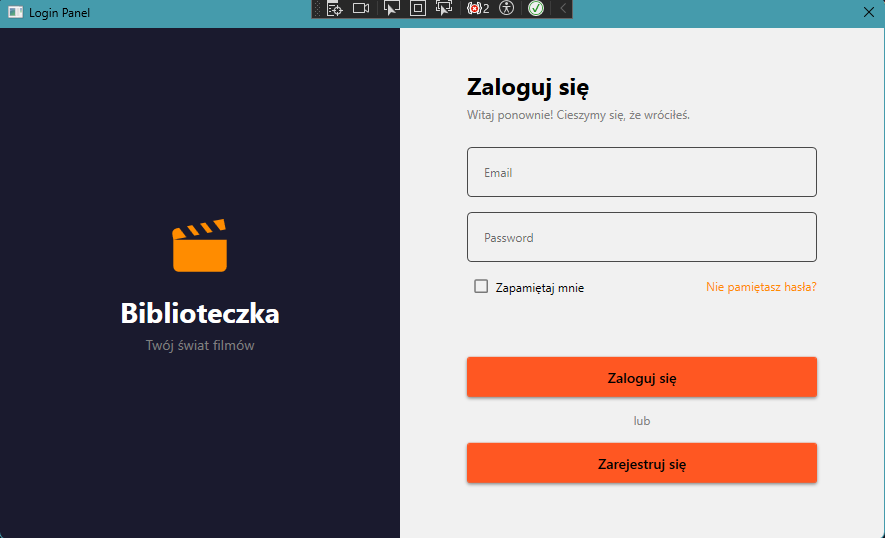
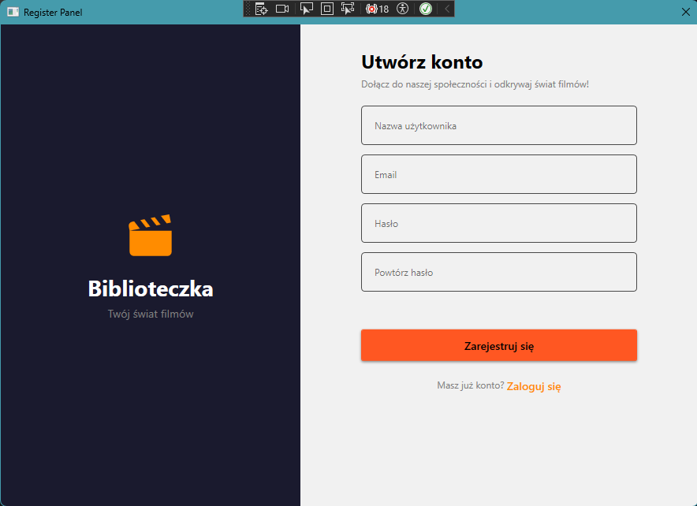
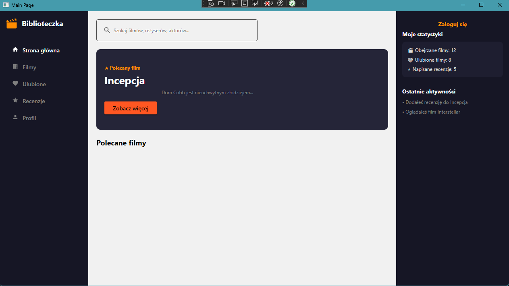

# Biblioteczka


A hobby project for browsing and managing a movie catalog, built with a WPF desktop client and an ASP.NET Core REST API. The project is a work in progress.

## Screenshots

| Login Panel | Register Panel | Main Window |
|---|---|---|
|  |  |  |

## Overview

The solution contains a WPF desktop client and a separate ASP.NET Core REST API. The client communicates with the API over HTTP using JSON.

### Implemented features

- **Authentication:** User registration and login, JWT authentication, and role-based authorization for protected API operations.
- **Movie catalog:** Browse movies and view movie details.
- **Admin operations:** Add or update movies and upload movie posters.
- **User profiles:** Authenticated users can upload an avatar.
- **Desktop UI:** WPF screens for login, registration, browsing movies, and adding movies, using Material Design in XAML.

People and review entities are present in the domain model, but their API and UI workflows are still in progress.

## Tech stack

- **Language and framework:** C# and .NET 10
- **Desktop UI:** WPF and XAML
- **Backend:** ASP.NET Core Minimal APIs
- **Data access:** Entity Framework Core and SQLite
- **Authentication:** JWT and BCrypt password hashing
- **Other:** Dependency Injection, shared request/response contracts, and Material Design in XAML

## Solution structure

```text
Biblioteczka/                  # WPF client (Biblioteczka.UI)
Biblioteczka.API/              # ASP.NET Core REST API
Biblioteczka.Contracts/        # Shared requests, responses, and DTOs
Biblioteczka.Core/             # Domain entities
Biblioteczka.DAL/              # EF Core migrations and data access dependencies
Biblioteczka.Services/         # Application services and business logic
Biblioteczka.Shared/           # Shared result and error types
```

## Run locally

### Prerequisites

- .NET 10 SDK
- Visual Studio with the .NET desktop development workload and WPF support

### Setup

1. Open `Biblioteczka.slnx` in Visual Studio.
2. Configure local JWT settings for the API with .NET User Secrets. The key below is only a placeholder; use your own random secret and do not commit it.

   ```powershell
   dotnet user-secrets set "JwtSettings:SecretKey" "replace-with-a-random-secret-of-at-least-32-characters" --project .\Biblioteczka.API\Biblioteczka.API.csproj
   dotnet user-secrets set "JwtSettings:Issuer" "Biblioteczka.API" --project .\Biblioteczka.API\Biblioteczka.API.csproj
   dotnet user-secrets set "JwtSettings:Audience" "Biblioteczka.UI" --project .\Biblioteczka.API\Biblioteczka.API.csproj
   ```

3. Create and update the local SQLite database by running EF Core migrations from the repository root:

   ```powershell
   dotnet ef database update --project .\Biblioteczka.DAL\Biblioteczka.DAL.csproj --startup-project .\Biblioteczka.API\Biblioteczka.API.csproj
   ```

   *(Note: If `dotnet ef` is not available, install the EF Core CLI tools globally via `dotnet tool install --global dotnet-ef`)*

4. Configure Visual Studio to start both projects:
   - Right-click the solution and select **Properties**.
   - Under **Common Properties**, select **Startup Project**.
   - Choose **Multiple startup projects**.
   - Set both `Biblioteczka.API` and `Biblioteczka.UI` to **Start**.
5. Press **F5**. Visual Studio starts the API and WPF client together. The client is configured to connect to the API at `https://localhost:7262`.

## Roadmap

- [ ] Complete the API and UI workflows for people (cast and crew).
- [ ] Add movie ratings and review submission.
- [ ] Add database seeding for easier local setup.
- [ ] Improve WPF loading states and error notifications.

## Repository hygiene

Do not commit local SQLite database files, uploaded user avatars, secrets, or Visual Studio user-specific files. Only include poster and avatar assets that are safe to redistribute. Store local JWT settings outside the source tree, for example with .NET User Secrets.